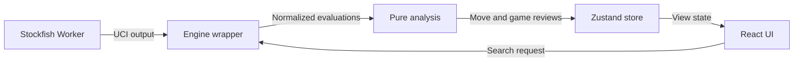

# ChessLens architecture

## Browser runtime

The play page uses React and react-chessboard for input and presentation.
chess.js owns legality, SAN, position history, and chess end conditions.
Zustand owns the live game, viewed ply, orientation, bot configuration,
and result. A versioned localStorage record stores PGN and game settings.
Loading the PGN replays the moves and preserves repetition history.
Historical board views are read-only. The bot always searches the live
position and submits a move only against the game instance it searched.

`StockfishEngine` owns its dedicated classic Worker. The play page uses
one instance per mount; the smoke page uses one per test. The smoke test
at `?view=smoke` searches the starting position at depth 10.

Both Vite dev and build copy the pinned engine, WASM, and license files
into `public/stockfish`. Vite serves those files in dev and copies
them into `dist/stockfish` during build. Production asset URLs are relative
to the document base so the app can be served below a static path prefix.

Stockfish 17.1 Lite is single-threaded and works without SharedArrayBuffer.
A future threaded build would require a secure context and cross-origin
isolation with these server response headers:

```http
Cross-Origin-Opener-Policy: same-origin
Cross-Origin-Embedder-Policy: require-corp
```

At that point, verify `crossOriginIsolated` and check that cross-origin
resources opt in via CORS or an appropriate CORP policy.

## Planned module boundaries



The application workflow invokes the engine and passes its results into
pure analysis functions, then commits the result to the store. The analysis
module imports only data contracts and pure helpers.

## Game review

The review route is `?view=review`. It accepts pasted PGN, a PGN file, or
the latest game from the play store. The importer separates games at
top-level result markers and headers. chess.js validates the main line
and reconstructs the starting FEN and each subsequent position.

The pipeline passes the initial FEN and move history to Stockfish to
preserve repetition context. It processes one position at a time with
MultiPV 3 and depth 12, 16, 18, or 20. Checkmate and stalemate are assigned
fixed evaluations. The position builder also treats insufficient
material as a fixed draw. PGN variations and comments do not become
analysis branches.

`src/types/review.ts` defines `GameReview`, `ReviewPosition`,
`PositionEval`, and `AnalysisLine`. Positions and evaluations align by
ply, including ply 0. Each line preserves depth, a White-perspective
centipawn or mate score, and paired UCI/SAN moves. A separate winner
field distinguishes terminal mate scores of zero. The eval bar and
graph use the same tanh scale for centipawns, with mates at the endpoints.
Flipping the board moves the White segment to the opposite end of the
bar. The graph remains in White's perspective.

The analysis worker cache handles repeat positions. Completed reviews
are also saved in localStorage under a SHA-256 hash of canonical PGN
and depth. The latest completed review is restored when opening the
review route. Classification in Phase 3 can derive a move-level result
from the evaluations before and after the corresponding ply.

## Engine API

- `init()` starts the Worker, sends `uci`, then awaits `isready`.
- `setOption(name, value)` applies a UCI option and waits for readiness.
- `newGame()` cancels a search, sends `ucinewgame`, and waits for readiness.
- `analyze(fen, { depth, movetime, multiPV, moves, signal, cache })` searches
  the FEN and optional UCI move history. It resolves with `bestMove`,
  `ponder`, and the latest scored principal variation per rank. Raw UCI
  scores use the side-to-move perspective. The review pipeline normalizes
  scores to White’s perspective.
- `stop()` cancels the latest request and waits for cleanup.
- `destroy()` terminates the Worker and releases pending work.

The engine serializes operations. A newer search cancels the prior one.
An active cancellation sends `stop` and drains that search through
`bestmove` before queued work can send another command. Every search
waits for an `isready` barrier after configuring MultiPV. A Worker error,
30-second response timeout, or 3-second stop timeout resets the Worker.
Pending searches can also be cancelled using an AbortSignal.

The analysis cache is a 96-entry LRU Map keyed by FEN, move history,
depth, time, MultiPV, and option values. The map belongs to one engine
instance. Bot moves bypass the cache so weak play can vary. Draw offers
use full skill and accept only exact centipawn scores within ±50; mate
scores and absent scores are treated as declines.

## Bot levels

`src/engine/bot-levels.ts` is the source of truth. Skill uses Stockfish's
0–20 scale. Each search uses both a depth target and a time cap. The levels
represent relative difficulty and have no assigned Elo.

| Level | Skill | Depth | Time (ms) |
| ----- | ----- | ----- | --------- |
| 1     | 0     | 3     | 100       |
| 2     | 2     | 4     | 140       |
| 3     | 4     | 5     | 200       |
| 4     | 7     | 6     | 280       |
| 5     | 10    | 8     | 400       |
| 6     | 13    | 10    | 650       |
| 7     | 16    | 12    | 950       |
| 8     | 20    | 15    | 1500      |

## Decision log

| Choice                              | Reason                                                                    |
| ----------------------------------- | ------------------------------------------------------------------------- |
| Vite + React 18 + strict TypeScript | Fast dev iteration and typed boundaries without a backend.                |
| Tailwind CSS                        | Keep responsive layout and focus styles close to the UI.                  |
| Zustand                             | Share workflow and review state across views with selector subscriptions. |
| chess.js                            | Validate moves and parse FEN and PGN using one rules library.             |
| react-chessboard                    | React 18-compatible board with drag-and-drop and click handling.          |
| Stockfish 17.1 Lite                 | Small browser payload and no cross-origin isolation requirement.          |
| Recharts                            | React components for the review evaluation chart.                         |
| Vitest, ESLint, Prettier            | Run TypeScript tests and keep source checks and formatting repeatable.    |
| Husky omitted                       | Keep the optional Git hook out of the initial scaffold.                   |
